<h1 align="center"></h1>

<p align="center">
  <b>Run several Roblox accounts at once.</b><br>
  Sign in once, tick the accounts you want, pick a game, press <b>Launch</b>.<br>
  <sub>Lantern, or <b>LRAM</b> for short.</sub>
</p>

<p align="center">
  <a href="src/Lantern"></a>
  <a href="https://github.com/Foxems/LRAM/issues"></a>
</p>

<p align="center">
  <a href="https://github.com/Foxems/LRAM/actions/workflows/build.yml"></a>
  <a href="LICENSE"></a>
  
  
  
</p>

<p align="center">
  <a href="#what-it-does">Features</a> ·
  <a href="#a-look-around">Screenshots</a> ·
  <a href="#getting-started">Getting started</a> ·
  <a href="#how-your-cookies-are-protected">Security</a> ·
  <a href="#building">Building</a>
</p>

> [!CAUTION]
> **Read this before you use Lantern.**
>
> Lantern is an unofficial hobby project. It is not made, endorsed or supported by Roblox, and "Roblox" is a trademark of Roblox Corporation.
>
> **You use it at your own risk.** I take no responsibility for anything that happens to your Roblox accounts: bans, locked or stolen accounts, lost items or Robux, or anything else. Running several accounts or several windows at once may go against Roblox's rules, Roblox can change what it allows without warning, and it can act on an account for any reason.
>
> **I have no access to your accounts.** Lantern has no server and no telemetry. Your sign-in cookies stay on your PC, encrypted, and are only ever sent to roblox.com. A cookie is as good as a password, so never share one, with me or anyone else.
>
> **This is a personal project, not a service.** Updates are not guaranteed. I may stop working on it, or archive this repository, at any time and without notice, and I am under no obligation to fix bugs, add features, answer issues or keep Lantern working when Roblox changes something.
>
> The software is provided "as is", without warranty of any kind. See [LICENSE](LICENSE).

> [!NOTE]
> **Windows may warn about an "unknown publisher" or say "Windows protected your PC" the first time you run Lantern. That is normal.** The exe isn't code-signed: a signing certificate costs money every year, and Lantern is a free hobby project. The warning only means Windows doesn't know the publisher, not that something is wrong with the file. Click **More info → Run anyway**. If you'd rather not trust a download, [build it yourself](#building) from the source here, or compare the zip's checksum with `SHA256SUMS.txt` on the release.

<picture>
  <source media="(prefers-color-scheme: dark)" srcset="docs/accounts-dark.png">
  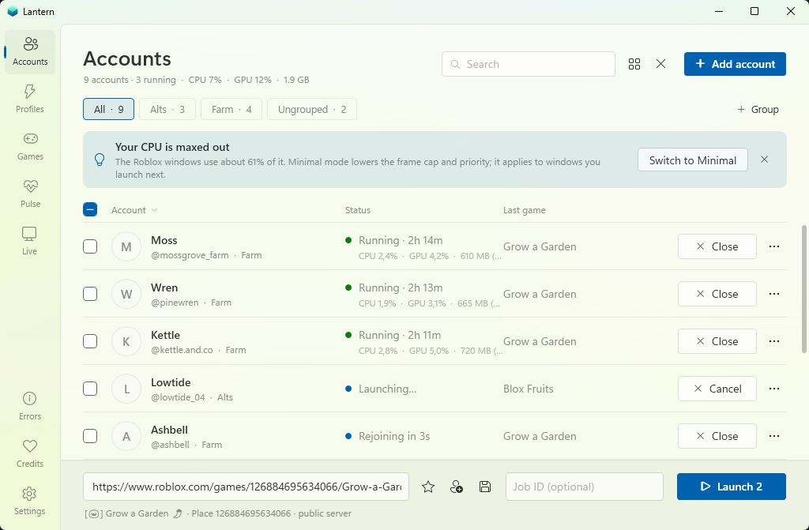
</picture>


<h2><a id="what-it-does"></a></h2>

- **Keeps your accounts in one place.** Add them by signing in (2-step verification works) or by pasting a cookie. Group them, rename them, put them in the order you like.
- **Launches many at once.** One window per account, started one after another with a delay (6 seconds by default) so your PC and Roblox's rate limits keep up. You can cancel part way through.
- **Rejoins when a window drops.** If a window crashes, or Roblox disconnects it and leaves it on an error screen, Lantern can close it and join the same place again. It reads the reason from Roblox's own log, backs off after outages, and gives up after a number of failed tries you choose. This is off until you switch it on.
- **Joins the right server.** Public games, private-server links, share links, a specific server id, or "wherever this friend is". You can also send your other accounts to the server one of them is already in.
- **Saves what you use often.** Games, and launch profiles ("these five accounts, this game, this private server").
- **Tells you what went wrong.** A failed launch or a closed window gets a plain explanation and a suggestion. The Errors page lists every Roblox disconnect code Lantern knows.
- **Keeps many windows light.** Optional low-resource modes (graphics level, frame cap, window size, efficiency mode), live CPU, GPU and memory per window, and an optional trim or cap for the memory of minimized windows.
- **Shows the whole farm.** *Pulse* has the numbers (how long each account was online, how often windows drop, whether a setting costs stability). *Live* shows every running window as a tile in one grid. Stream mode there blurs account names if you share your screen, and a small "what is this, where to get it" block stays on screen so people who see your stream know what they are looking at.
- **Looks like it belongs on Windows.** Light, dark or follow Windows. It uses your Windows accent colour and a Mica backdrop on Windows 11.


<h2><a id="a-look-around"></a></h2>

Every screenshot here was taken in `--demo` mode: the accounts are made up and nothing real was read or sent.

<table>
  <tr>
    <td width="50%" valign="top">
      <b>Profiles</b><br>
      Save "these accounts, this game, this server" and start the whole crew with one click, or from Task Scheduler.<br><br>
      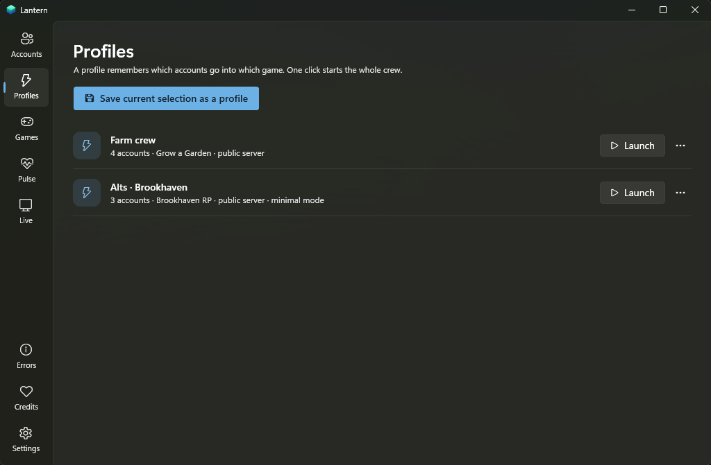
    </td>
    <td width="50%" valign="top">
      <b>Games</b><br>
      Keep the places you farm often. Pick one and it fills the launch bar.<br><br>
      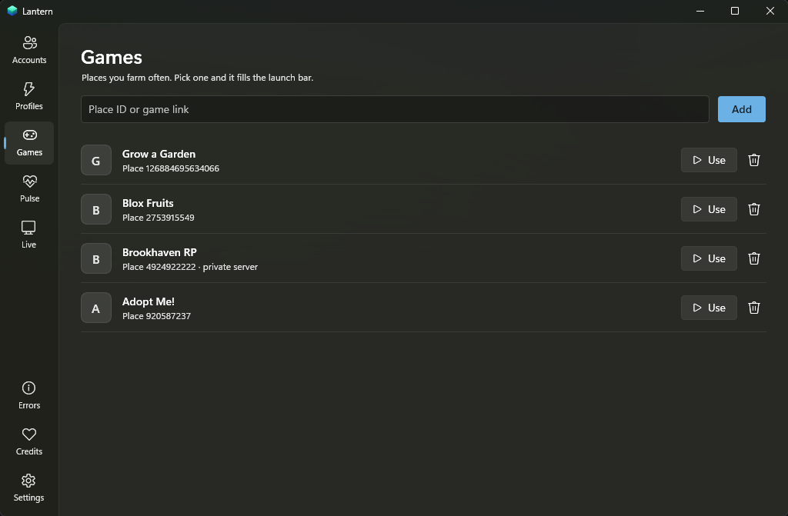
    </td>
  </tr>
  <tr>
    <td width="50%" valign="top">
      <b>Live</b><br>
      Every window as a tile in one grid, with the numbers for this PC beside it.<br><br>
      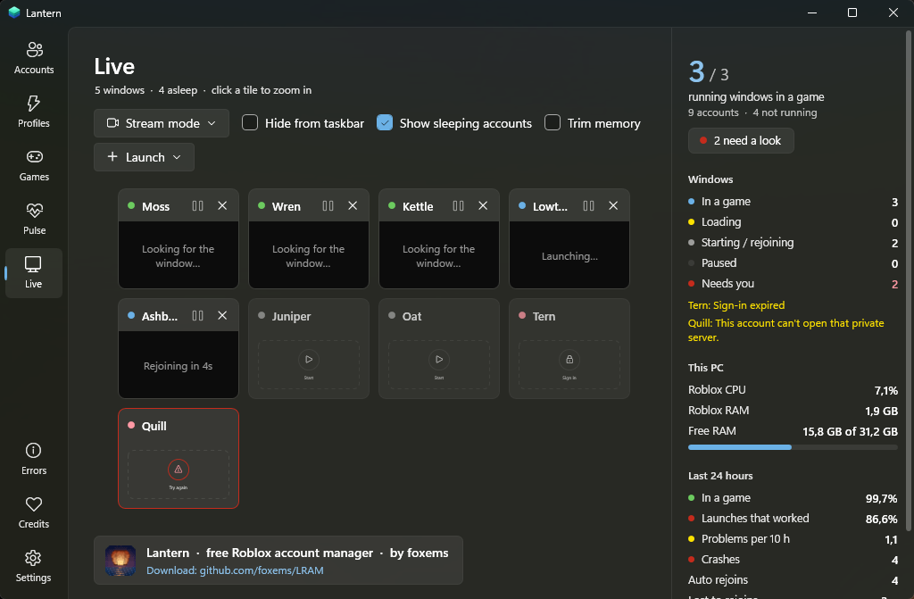
    </td>
    <td width="50%" valign="top">
      <b>Pulse</b><br>
      Is every window really inside a game? How often do they drop? Read from Roblox's own logs.<br><br>
      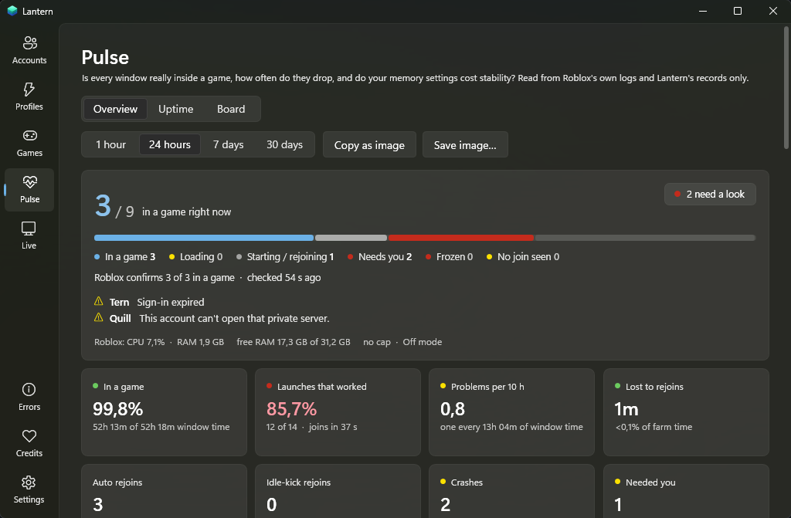
    </td>
  </tr>
  <tr>
    <td width="50%" valign="top">
      <b>Errors</b><br>
      What each Roblox disconnect code means and what Lantern does about it.<br><br>
      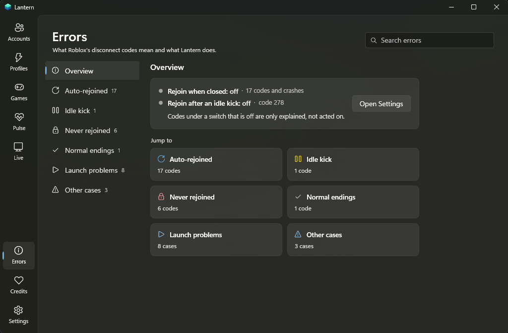
    </td>
    <td width="50%" valign="top">
      <b>Settings</b><br>
      Launch delay, staying online, performance, appearance and privacy, all searchable.<br><br>
      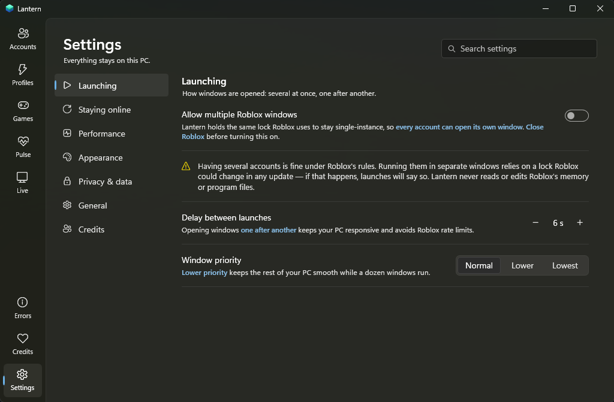
    </td>
  </tr>
  <tr>
    <td width="50%" valign="top">
      <b>First run</b><br>
      A thank-you, then the disclaimer, a theme and your switches.<br><br>
      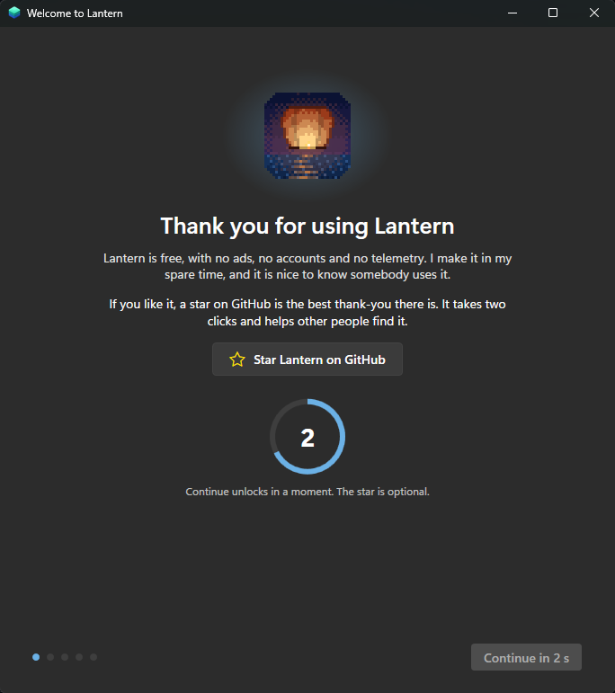
    </td>
    <td width="50%" valign="top">
      <b>How sign-ins are kept safe</b><br>
      Real ciphertext from your own PC, so you can see what is stored.<br><br>
      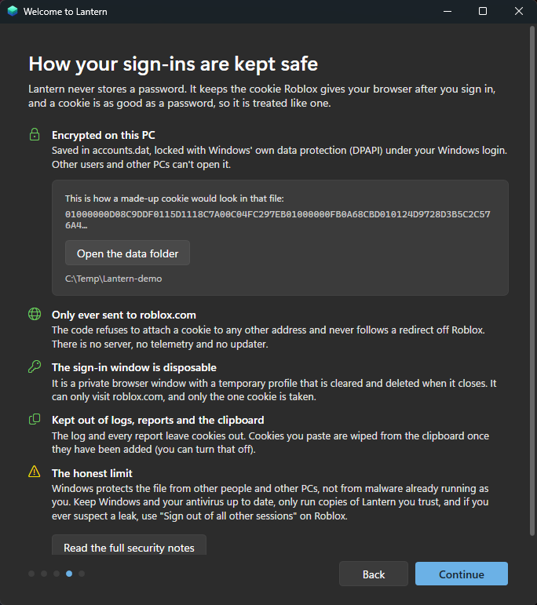
    </td>
  </tr>
</table>

### Light or dark

<table>
  <tr>
    <td width="50%">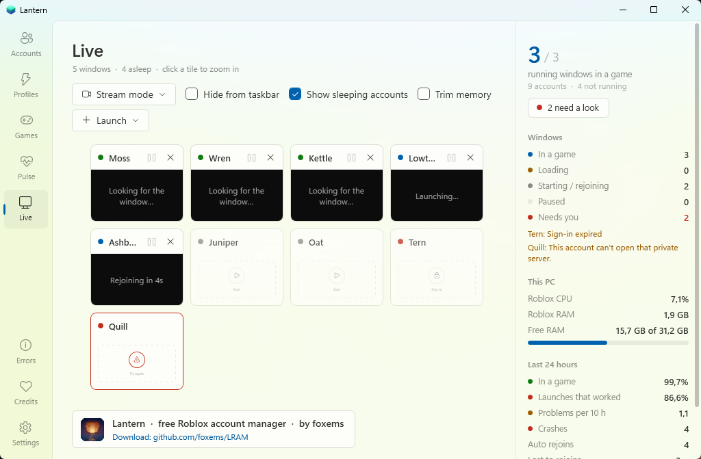</td>
    <td width="50%">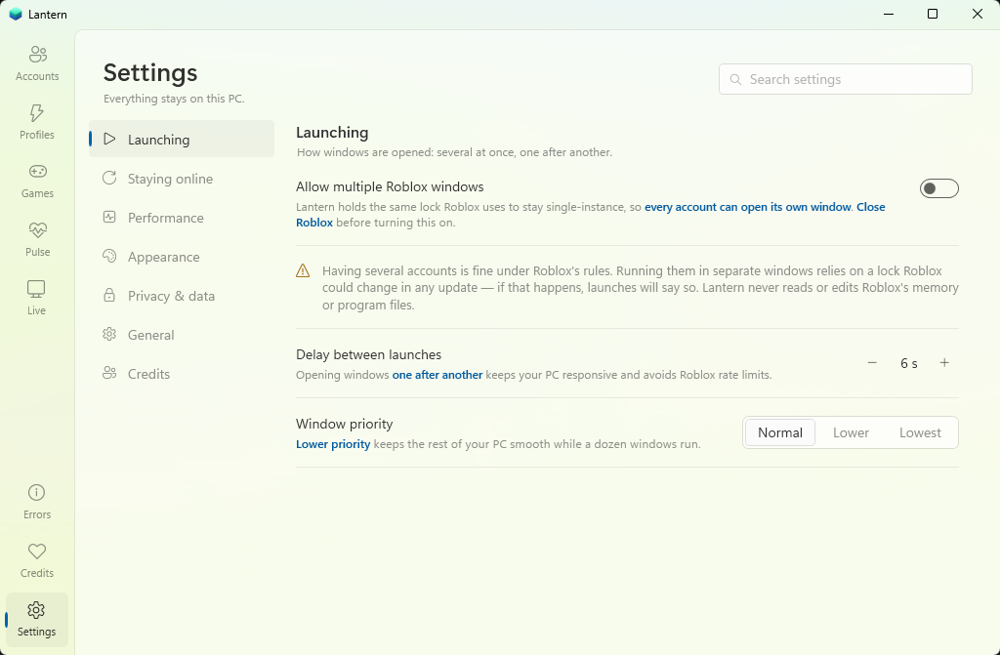</td>
  </tr>
</table>


<h2><a id="getting-started"></a></h2>

You need Windows 10 or 11, Roblox installed from [roblox.com](https://www.roblox.com/download) (the Microsoft Store version is not supported) and, for the sign-in window, the Microsoft Edge WebView2 runtime, which Windows 11 already has.

1. Download the latest zip from [Releases](https://github.com/Foxems/LRAM/releases/latest), unpack it anywhere and run `Lantern.exe`. There is no installer.
2. Windows may show a SmartScreen warning the first time, because the exe isn't code-signed (see the note at the top). Either build it yourself ([below](#building)) or only run a copy you trust.
3. The first run starts with a short thank-you (Continue unlocks after five seconds), then walks you through the disclaimer, the theme, and how your sign-ins are kept safe.
4. In **Settings → Launching**, turn on *Allow multiple Roblox windows*. Close Roblox first.
5. Press **Add account**, sign in or paste a cookie, tick the accounts, paste a place id or game link, and press **Launch**.

Ctrl+V on the Accounts page, or dropping a text file on the window, also works: if there is a cookie in it, the add dialog opens already filled in. Lantern wipes the cookie from the clipboard once the accounts are added (you can turn that off).

Want to look around first? Run `Lantern.exe --demo` for made-up accounts that never touch Roblox.


<h2><a id="how-your-cookies-are-protected"></a></h2>

The short version:

- Cookies are stored in `%APPDATA%\Lantern\accounts.dat`, encrypted with Windows DPAPI under your Windows login. Other users and other PCs can't read it. Writes are atomic and a `.bak` is kept.
- A cookie is only attached to requests to `*.roblox.com`. The code refuses any other host and never follows a redirect off Roblox.
- The sign-in window is a private WebView2 window with a temporary profile that is cleared and deleted when it closes. It can only visit roblox.com and only the one cookie is taken.
- Cookies never go into the log, the health report or the Pulse report. The log also blanks anything shaped like a cookie before it is written.
- There is no server, no telemetry and no auto-updater.

What it does **not** protect against: malware that already runs as you. It can ask Windows to decrypt the file the same way Lantern does, just like it can with your browser's saved sessions. Keep Windows and your antivirus up to date.

The full list of what is stored where, what leaves your PC, and how to check it yourself is in [SECURITY.md](SECURITY.md). The first-run setup shows the same thing, with real ciphertext from your PC.


<h2><a id="things-worth-knowing"></a></h2>

- **Closing Lantern closes the Roblox windows it started.** Roblox windows keep checking the multi-window lock, and when Lantern lets go of it they shut themselves down. Lantern asks before it closes. To keep farming, minimize it or turn on the tray icon.
- **The multi-window lock is not guaranteed.** It relies on Roblox leaving its single-instance lock alone, and Roblox has been tightening that. An update can break it.
- **Lantern keeps its own copy of the Roblox client** (about 350 MB, under `%LOCALAPPDATA%\Lantern\Roblox`) and launches accounts from it. It is copied from your official install or downloaded from Roblox's own servers and checked against Roblox's published checksums. The reason is that Roblox's installer closes every open window when it swaps builds, and a copy with no installer next to it can't do that.
- **Low-resource mode edits Roblox's own settings file** (`GlobalBasicSettings_13.xml`) and, if you allow it, a `ClientAppSettings.json` with flags from [Roblox's published allowlist](https://devforum.roblox.com/t/allowlist-for-local-client-configuration-via-fast-flags/3966569). Every original value is remembered and put back when the last window closes, or on demand under *Settings → Restore Roblox's original settings*.
- **Nothing inside the Roblox client is read, written or injected.** Lantern holds a named Windows lock, asks Roblox for a launch ticket the way the website does, hands it to Roblox's own `roblox-player:` handler, reads Roblox's log files, and uses normal window and scheduling calls.
- **A launch ticket is briefly visible** on the Roblox process's command line (single use, about a minute). It is the same as pressing Play on the website.
- Roblox still removes players after about 20 minutes without input. Lantern doesn't send input, but it can rejoin after an idle kick if you ask it to.
- Accounts that only sign in with Google or Apple can be added with *Paste cookie*.


<h2><a id="command-line"></a></h2>

```text
Lantern.exe --launch="Farm crew"   start a saved profile (Task Scheduler, shortcuts)
Lantern.exe --no-splash            skip the start screen once
Lantern.exe --demo                 sample accounts in a throw-away folder; nothing real is read or sent
LANTERN_HOME=D:\lantern-data       keep the data in another folder (portable use)
```


<h2><a id="building"></a></h2>

You need the [.NET 8 SDK](https://dotnet.microsoft.com/download). The project itself targets .NET Framework 4.8, which Windows includes.

```powershell
.\build.ps1            # -> dist\Lantern
.\build.ps1 -Zip       # also dist\Lantern-1.0.0-win-x64.zip
.\build.ps1 -Test      # also runs the self-tests
```

`build.ps1` uses a `dotnet` on your PATH, or downloads a private SDK into `.tools\` if there isn't one. Nothing is installed system-wide and no admin rights are needed.

```text
src/Lantern/Core    accounts and storage, the Roblox web client, launching and rejoining, log reading,
                    low-resource mode, usage, health and security checks, statistics
src/Lantern/UI      the WPF window, dialogs, first-run setup, sign-in window, tray
tests/Selftest      link parsing, cookie handling, encrypted storage, the credential guard, the lock,
                    the launch URI, a few live checks against Roblox (--offline skips those)
```

### Automatic builds

[`.github/workflows/build.yml`](.github/workflows/build.yml) runs `build.ps1 -Zip -Test -Offline` on a clean Windows runner for every push and pull request, and attaches the zip to the run as an artifact. Pushing a version tag also publishes it as a release:

```powershell
git tag v1.0.1
git push origin v1.0.1
```

Pull requests and issues are welcome, see [CONTRIBUTING.md](CONTRIBUTING.md).


<h2><a id="project-status"></a></h2>

Lantern is something I look after in my own time. It is not a live service, and nothing here is a promise: there is no roadmap, no release schedule and no support commitment. I may go quiet for months, and I may archive the repository one day. Issues and pull requests are welcome, but I can't promise to answer or merge them. If Lantern is useful to you, keep a copy of a version that works, and feel free to fork it.


<h2><a id="credits-and-license"></a></h2>

Made by [foxems](https://github.com/foxems). You can also find me on Discord: **foxems**. The same details are in the app, on the **Credits** page in the left rail.

Lantern is free, with no ads, no accounts and no paid tier. Released under the [MIT license](LICENSE). The sign-in window uses Microsoft's [WebView2](https://developer.microsoft.com/microsoft-edge/webview2/), whose libraries ship in the zip under their own license (see [THIRD-PARTY-NOTICES.txt](THIRD-PARTY-NOTICES.txt)).

Not affiliated with or endorsed by Roblox Corporation.


